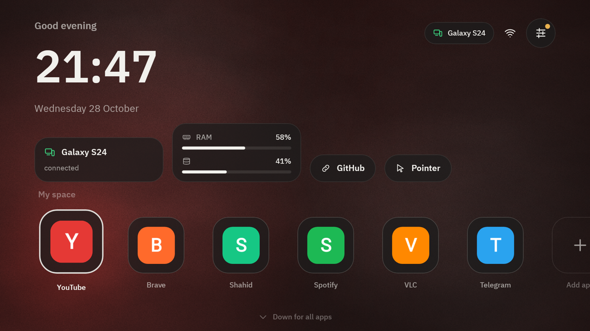

# TV Hub

نظام كامل لتلفزيون **Xiaomi TV Box S (3rd Gen)** وأي Google TV، وريموت ذكي على جوالك. **APK واحد** للجهازين.



## على التلفزيون: نظامك أنت
- يفتح وحده مع تشغيل التلفزيون ويصبح الواجهة الرئيسية.
- **كل التطبيقات**، بما فيها تطبيقات الجوال التي يخفيها Google TV.
- **مساحتي**: الشاشة الرئيسية لا تعرض إلا ما تختاره.
- خلفية حجرية تتحرك ببطء، وإضاءة محيطية بلون التطبيق الذي تقف عليه.
- **مؤشر ماوس** يظهر وحده في تطبيقات الجوال. ضغطة مطوّلة على OK تُظهره أو تخفيه.
- **إضافة تطبيق**: من جوالك، أو من USB/التنزيلات، أو من رابط.
- الإعدادات: الواجهة، الجوالات وصلاحياتها، الإعداد، النظام، الخدمات.

## على الجوال: ريموت بلا أزرار تقريبًا
- يتصل وحده بالتلفزيون، ويعيد الاتصال وحده.
- **اسحب** للأسهم و**انقر** للاختيار. ثلاثة أزرار فقط: رجوع، الرئيسية، المزيد.
- أزرار الصوت في الجوال تتحكم بصوت التلفزيون.
- الكيبورد يفتح وحده عندما يركّز التلفزيون على حقل نص.
- **الشاشة المباشرة** مع اللمس، و**الماوس**، و**الجهاز** (قراءات حقيقية فقط)، و**التطبيقات** (ونقل أي تطبيق من جوالك)، و**الملفات**، و**الخدمات** (Node/Python عبر Termux)، و**الطرفية**.

## التثبيت (مرة واحدة)
1. ثبّت `app-release.apk` على الجوال والتلفزيون.
2. على التلفزيون: **الإعدادات ← الإعداد ← وضع ADB** (ضغطة واحدة، بلا كمبيوتر).
   - إن طلب: فعّل خيارات المطوّر (الإعدادات ← حول ← اضغط «رقم البنية» 7 مرات) ثم «تصحيح USB».
   - تظهر رسالة «السماح بتصحيح USB؟»: فعّل «السماح دائمًا» ثم «سماح».
   - بعدها يضبط TV Hub نفسه: إمكانية الوصول، والصلاحيات، والشاشة الرئيسية إن اخترتها.
3. افتح التطبيق على الجوال، فيظهر التلفزيون وحده. اضغط **OK** على الريموت. انتهى، وكل اتصال بعدها صامت.

### لماذا وضع ADB؟
TV Hub يتصل بـ ADB الخاص بالتلفزيون نفسه (`127.0.0.1:5555`)، فيملك ما يملكه كمبيوتر موصول بكابل، بلا روت:
| بدون ADB | مع ADB |
|---|---|
| الأسهم عبر إمكانية الوصول (تحريك التركيز) | أحداث أزرار حقيقية مثل الريموت تمامًا |
| مشاركة الشاشة تحتاج موافقة، وبعض الأجهزة حذفت نافذتها | `screenrecord` بلا أي طلب |
| التثبيت يطلب تأكيدًا على التلفزيون | تثبيت صامت، مع شرح واضح إن كان التطبيق 64-بت فقط |
| إمكانية الوصول قد تنطفئ بعد تحديث | يعيد تفعيلها بنفسه |

بديل الكمبيوتر ما زال موجودًا: `tools/tv-setup.sh <IP-التلفزيون> app-release.apk`.

## ما لا يمكن (بصدق)
- الفيديو المحمي (نتفلكس وأمثاله) يظهر أسود في البث: Android يمنع تصويره ولن نتجاوز ذلك.
- استخدام المعالج الكلي واستخدام الرسوميات: Android لا يتيحهما للتطبيقات، فيُكتب «غير متاح» مع السبب.
- بدون وضع ADB: أول بث بعد تشغيل التلفزيون قد يطلب موافقة على التلفزيون (قاعدة في Android 14).
- التطبيقات المبنية لـ 64-بت فقط لا تعمل على نظام 32-بت (مثل بعض صناديق Allwinner). TV Hub يقولها صراحة بدل «غير متوافق».
- أغلب الصناديق تنسى ADB الشبكي عند إعادة التشغيل؛ TV Hub يحاول تثبيته، وإن لم يسمح النظام تكفي ضغطة «وضع ADB» مرة أخرى.

## البناء والاختبار
```bash
./gradlew test               # وحدات + تكامل الشبكة + End-to-End + Robolectric + لقطات
./gradlew :app:assembleRelease
tools/test/tv-setup.test.sh  # سكربت الإعداد ضد adb وهمي
```
المعمارية: [docs/ARCHITECTURE.md](docs/ARCHITECTURE.md) · الواجهة: [docs/UX.md](docs/UX.md) · الخطة: [docs/PLAN.md](docs/PLAN.md)
